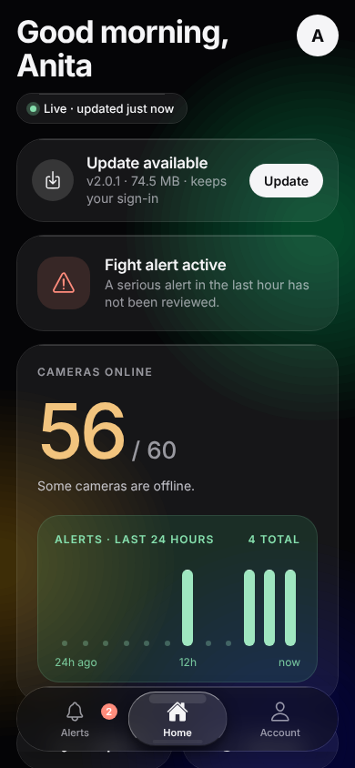

# CampusGuard Website

**The front door to CampusGuard: where a school signs up, manages its account and sees how its cameras are doing.**

CampusGuard watches a school's existing CCTV for fights and alerts staff within seconds. The [desktop app](https://github.com/hisir-sys/campusguard) does the watching. This website and the phone app are how people get access and stay informed.

## The problem

Schools need to trust a safety product before they install it on their cameras. They want to know who is behind it, how their data is handled, and that only approved schools get in. Once it is running, the head of school also needs to see, from anywhere, whether the cameras are healthy and whether anything has happened, without sitting at the office PC.

## What it does

- **Explains the product** to schools and answers privacy questions in plain language, with a public privacy notice.
- **Controlled early access.** A school applies once and the owner approves login and payment separately, so only approved schools can sign in or download the installer.
- **One account everywhere.** Schools set their name, contact number and the phone numbers that receive alerts, and the same details appear in the website, the phone app and the desktop app.
- **A summary of what is happening.** Cameras online, recent alerts and incident counts from each school PC. Only summaries and incident details are synced. Video never leaves the school.
- **A private installer download.** Approved accounts get a short-lived link to the desktop installer.

## The phone app

*Demo data.*

An Android app (`mobile/`) for the head of school and staff. It shows how many cameras are online, the last day of alerts and which areas are busiest, and sends a push to a closed phone when a serious alert fires. It signs in with the same account as the website and reads only through the website's API. It is installed from an APK, not an app store.

## Why it is built this way

- **Privacy first.** Footage stays on the school's PC. The website holds account details and summaries, nothing more, and every read goes through server-side checks.
- **Approval before access.** Login and payment are separate decisions, so a school can be let in for a pilot before paying.
- **One account, one place to change details.** No separate phone-number lists to keep in step.

## Status

Live for early access. Real push delivery, real WhatsApp alerts and clips in the app are still to be tested or built. See the [desktop README](https://github.com/hisir-sys/campusguard#readme) for the full picture.

Questions or a pilot: WhatsApp +91 70032 76998.

## More

- [Setup and operations](docs/SETUP.md): database, storage, environment, security
- [Privacy implementation notes](DPDP-IMPLEMENTATION.md)
- [Phone app developer notes](mobile/README.md)

## Licence

Copyright (c) 2026 CampusGuard. All rights reserved. This is proprietary software, not open source. Seeing it here does not give anyone the right to use, copy or share it. See [LICENSE](LICENSE).
